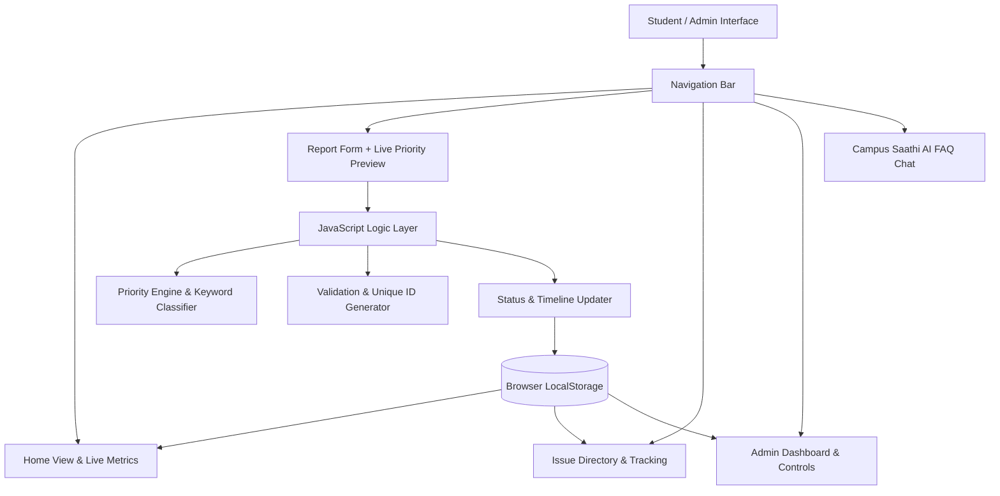

# 🎓 Campus Saathi AI
### Smart Campus Issue Reporting & Management System

> **Campus Saathi AI** is a lightweight, responsive web prototype designed to help students report campus problems, automatically prioritize urgent issues using a rule-based AI engine, and enable campus administrative staff to track each issue until it is resolved.

---

## 🌟 Key Features

1. **Student & Staff Authentication (Login & Sign Up)**:
   - Student Registration with full college profile: *Full Name, Roll Number, Department / Branch (CSE, IT, ECE, ME, CE, EE, MBA), Academic Year (1st–4th), Section, Email, Phone, and Password*.
   - 1-Click Quick Demo Login for instant testing:
     - **Student**: *Aditya Mehra (23CS1088, CSE 3rd Year)*
     - **Staff / Admin**: *Prof. Rajesh Sharma (Estate & Maintenance Office)*
   - Dynamic user profile pill in navbar with session persistence in `localStorage`.

2. **Campus QR Code Poster & Instant Mobile Reporting**:
   - **Visual QR Code Generator**: Generates an authentic QR code dynamically for the live campus instance (`http://localhost:5173/#qr-report`).
   - **Printable Poster**: College notice board / classroom sticker format with college title, instructions, and 1-click **"Print / Save Poster"** or **"Copy Link"**.
   - **Scan & Raise Ticket**:
     - Student scans the QR code from their mobile phone (or clicks *"Simulate Mobile Scan"* in the web portal).
     - Opens the dedicated **QR Problem Reporting Form**.
     - Student enters their College Details (*Name, Roll No, Branch, Year, Contact*) + Issue Details (*Category, Location, Problem Title, Description*).
     - **Direct Ticket Raising**: Submitting immediately raises the ticket on the **Admin Dashboard** with full student college identification tags and real-time counter updates!

3. **Smart Rule-Based Priority Engine**:
   - **Urgent Safety Flag**: Detects hazards such as *sparks, exposed wires, gas leaks, slip hazards, ragging, or medical emergencies* and flags them for immediate staff intervention.
   - **High Priority**: Automatically prioritizes essential academic equipment and core infrastructure (*projectors, computer labs, power cuts, drinking water coolers*).
   - **Medium Priority**: Campus facility issues (*Wi-Fi connectivity, fans, furniture, mess food*).
   - **Low Priority**: Routine maintenance (*cosmetic paint, gardening, notice board*).

3. **Persistent LocalStorage**:
   - All tickets and activity logs are stored in browser `LocalStorage`.
   - Data persists across browser page reloads without requiring complex database setups.

4. **Admin Control Center**:
   - Summary metric counters: *Total Issues, Open, In Progress, Resolved, Urgent Safety Alerts*.
   - Filter tickets by **Status** (*Open, In Progress, Resolved*) and **Priority** (*High, Medium, Low, Urgent Safety*).
   - Real-time search across ticket ID, title, and campus location.
   - One-click status management: Move tickets to **In Progress** and mark them **Resolved** with admin resolution remarks.

5. **Campus Saathi AI Assistant (FAQ Engine)**:
   - Interactive chatbot answering common campus questions:
     - 📽️ Computer lab projector troubleshooting & media cell contacts
     - 📚 Central library timings, book borrowing limits, and fines
     - 📶 Campus Wi-Fi & Eduroam login instructions
     - 🍽️ Hostel mess timings and complaint escalation
     - 🚨 24x7 Emergency health center and security contact numbers

6. **1-Click Guided Demo Scenario**:
   - Built directly to demonstrate the PDF prompt:
     > Report *"Computer lab projector is not working"* &rarr; Show Priority (*High*) &rarr; Open Admin Dashboard &rarr; Change status to *"In Progress"* &rarr; Mark it *"Resolved"*.

---

## 🏗️ Architecture & Component Model



---

## 🚀 How to Run the Project

### Option 1: Using Python Server (Recommended)
Run the bundled Python server in this folder:
```powershell
python server.py
```
This will automatically launch the prototype at:
**`http://localhost:5173`**

### Option 2: Direct File Open
You can open `index.html` directly in any modern browser (Chrome, Edge, Firefox, Brave):
- Double click `index.html` or drag and drop it into your browser.

---

## 🧪 Running Automated Tests
To verify all Priority Engine rules, component containers, and demo scenario logic:
```powershell
python test_suite.py
```
Output:
```text
========================================
Running Campus Saathi AI Test Suite
========================================
Testing file integrity...
[PASS] All 4 core files exist and are populated.
Testing HTML component structures...
[PASS] HTML contains all required component containers and demo triggers.
Testing Priority Engine rules from app.js...
[PASS] Priority Engine keyword rules verified successfully.
Testing Demo Scenario flow in app.js...
[PASS] Complete demo scenario flow (Steps 1 to 5) verified in codebase.
Testing Campus Saathi FAQ Knowledge Base...
[PASS] Campus Saathi FAQ assistant database verified.
========================================
ALL TESTS PASSED! Project is ready for demo.
========================================
```

---

## 🎬 How to Perform the Live Demo

1. Open the website and click the **"Run Demo"** button on the top banner or navbar.
2. **Step 1**: The form is pre-filled with *"Computer lab projector is not working"*. Click Submit.
3. **Step 2**: The Priority Engine instantly assigns **High Priority** with matched keywords `[projector, lab]`.
4. **Step 3**: The Admin Dashboard opens with the new ticket highlighted. Click **"In Progress"** to dispatch the technician.
5. **Step 4**: Click **"Resolve"** to mark the issue fixed.
6. **Step 5**: Notice all counters (*Total, Open, In Progress, Resolved*) update smoothly in real time!
